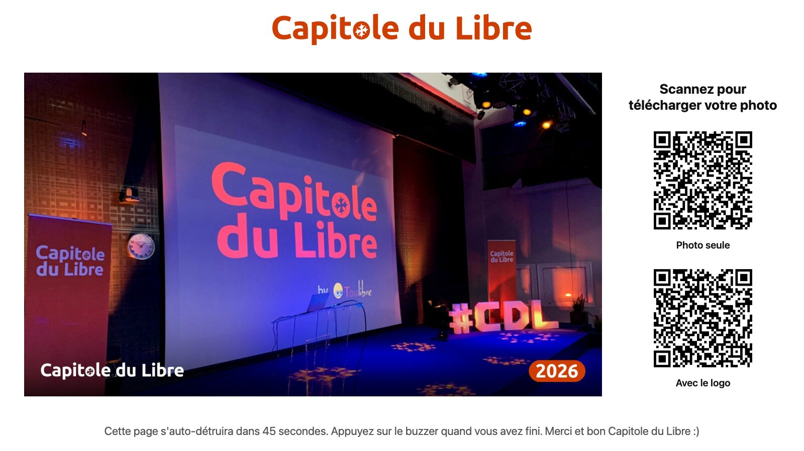
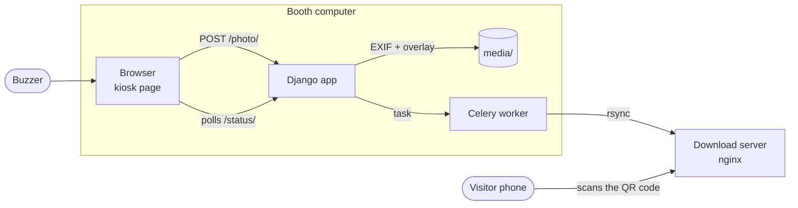

# 📸 Capitole du Libre Photobooth

**A self-hosted photobooth for events: press the buzzer, smile, scan the QR
code, and leave with your photo.**

Built for [Capitole du Libre](https://capitoledulibre.org), the free software
event in Toulouse. It runs in a web browser with a webcam, and visitors
download their photo on their phone. No app to install, no email address to
give.



## ✨ How it works

1. **Press the buzzer.** The screen shows a live mirror of the camera.
2. **Smile.** A 5 second countdown, a flash, and the photo is taken.
3. **Scan.** The photo shows up with the event logo, next to two QR codes:
   the plain photo and the photo with the logo overlay. The QR codes appear
   once the photo is online, so the link works as soon as it is scanned.
4. **Done.** The booth goes back to the camera after 45 seconds, or at the
   next press of the buzzer.

## 🎁 Features

- **Kiosk-friendly:** a single buzzer (mouse click or key press), no
  keyboard, no visible cursor, recovers by itself from upload errors and
  camera disconnections.
- **Good-looking photos:** captured at the camera's native resolution
  (up to 4K), cropped to 16:9, with GPS and date EXIF tags.
- **No yearly artwork:** the overlay (logo, year, colors) is generated, and
  its text defaults to the current year. Everything is configurable with
  environment variables.
- **Privacy-friendly:** no email address or personal data collected; photo
  file names contain a random UUID, so they cannot be guessed.
- **Simple to deploy:** one `docker compose up`.

## 🧰 Hardware

- A computer with a recent web browser (tested with Chromium/Chrome)
- A webcam, ideally 1080p or 4K
- A screen facing the visitors
- A buzzer that acts as a mouse click or a key press (a big USB button, or
  just a mouse)
- A network connection, to upload the photos to the download server

## 🚀 Quick start

You need [uv](https://docs.astral.sh/uv/), which also installs Python 3.12
if needed.

```sh
uv sync
uv run python manage.py migrate
uv run python manage.py runserver 8005
```

Open http://localhost:8005, allow the camera, and click anywhere to take a
photo. In development, photos are stored in `media/` and the upload to the
download server is skipped.

> [!NOTE]
> Browsers only give access to the camera on `localhost` or over HTTPS. Run
> the browser on the same machine as the server, or put the server behind
> HTTPS.

## 🎪 Running at the event

The production setup runs with Docker Compose: the Django app, a Celery
worker that uploads the photos with rsync, RabbitMQ and PostgreSQL.

1. **Set up the download server.** Any web server that serves a directory
   over HTTPS, reachable over SSH by rsync. For Capitole du Libre, it is an
   nginx serving `/srv/photo` at https://photo.capitoledulibre.org/. Its
   address and the rsync command are set in
   `photobooth/settings/production.py` (`PHOTOBOOTH_BASE_URL` and
   `PHOTOBOOTH_RSYNC_COMMAND`).
2. **Add the SSH key** allowed to rsync to that server as `ssh/id_rsa`. It
   must be readable by the `daemon` user of the container (world readable is
   fine).
3. **Start the booth:**

   ```sh
   docker compose up -d --build
   ```

   The app listens on http://localhost:8005.
4. **Open the page in kiosk mode** on the booth computer, for example
   `chromium --kiosk http://localhost:8005`, and allow the camera once.

## 🎨 Customizing the photo overlay

Photos are saved twice: as taken, and with an overlay made of a soft
gradient at the bottom, a logo on the left and a colored pill with a text on
the right. The overlay is generated by `photobooth/frame.py` and configured
with environment variables:

| Variable | Default | Description |
|---|---|---|
| `PHOTOBOOTH_FRAME_TEXT` | current year | Text of the pill; empty hides the pill. A text too long is shrunk to fit. |
| `PHOTOBOOTH_FRAME_COLOR` | `#d03d00` | Pill color (`#d03d00`, `d03d00` or a name like `navy`). The text is white or dark, whichever is more readable. |
| `PHOTOBOOTH_FRAME_LOGO` | Capitole du Libre logo | Path of the logo, a PNG with a transparent background. |
| `PHOTOBOOTH_FRAME_LOGO_COLOR` | `#ffffff` | Color the logo is painted in; empty keeps its original colors. |

With Docker, set them in the shell or in a `.env` file next to
`docker-compose.yml`. For a custom logo, put it in `./branding/`, which is
mounted in the container:

```sh
# .env
PHOTOBOOTH_FRAME_TEXT=#CDL2026
PHOTOBOOTH_FRAME_LOGO=/srv/app/branding/my-logo.png
```

Invalid values stop the app at startup with a clear message (they are
validated by `python manage.py check`, which `migrate` and `runserver` also
run), rather than failing on the first photo.

## 🏗️ Architecture



- `photobooth/views.py`: the kiosk page, photo upload, QR codes and
  publication status endpoints.
- `photobooth/frame.py`: the generated overlay.
- `photobooth/tasks.py`: the rsync task, which marks photos as published
  once they are online.
- `static/js/index.js`: the kiosk UI, a small state machine in plain
  JavaScript (no framework, no build step).

## 🛠️ Development

Install the git hooks once with [pre-commit](https://pre-commit.com/)
(`uv tool install pre-commit`, or `pipx`/`brew`), then:

```sh
uv run python manage.py test   # tests
pre-commit run --all-files     # linters (ruff, typos, ...)
uv run tox                     # both
```

To use PostgreSQL instead of SQLite in development, set
`BLEEMEO_DEVELOPMENT_DB=postgresql`.

To upgrade the dependencies:

```sh
uv lock --upgrade
uv export --no-dev --no-hashes > requirements.txt
pre-commit autoupdate
```

## 📄 License

The code is released under the [Apache License 2.0](LICENSE).

The Capitole du Libre logo and icon come from the
`capitoledulibre-branding` repository, released under
[CC BY 4.0](https://creativecommons.org/licenses/by/4.0/); the logo and name
are trademarks of Capitole du Libre. The Ubuntu font is released under the
[Ubuntu Font Licence](static/fonts/UFL.txt). The screenshot uses a photo of
the event venue: Capitole du Libre, CC BY 4.0.
